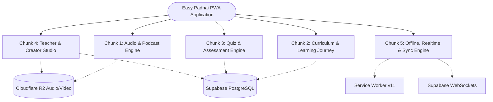
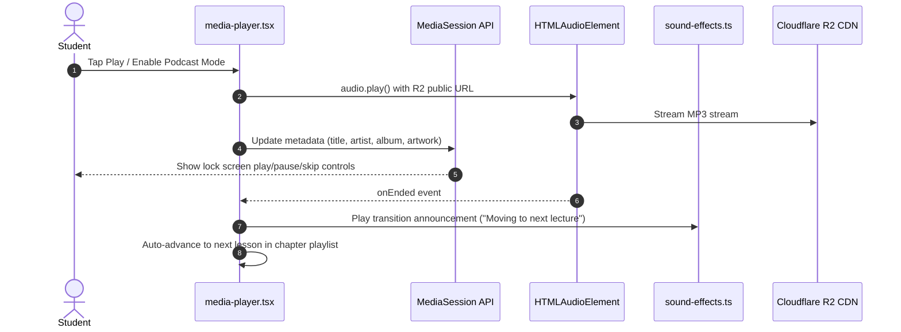
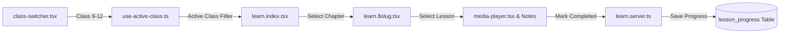
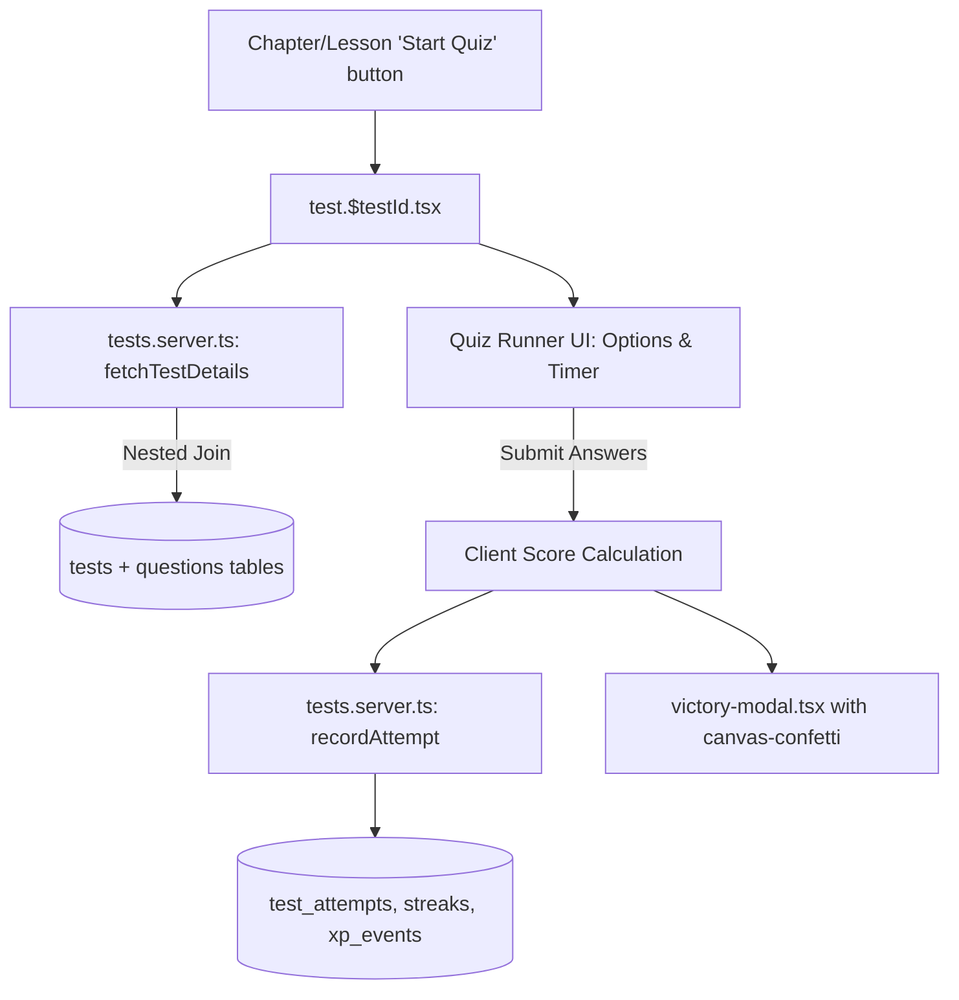
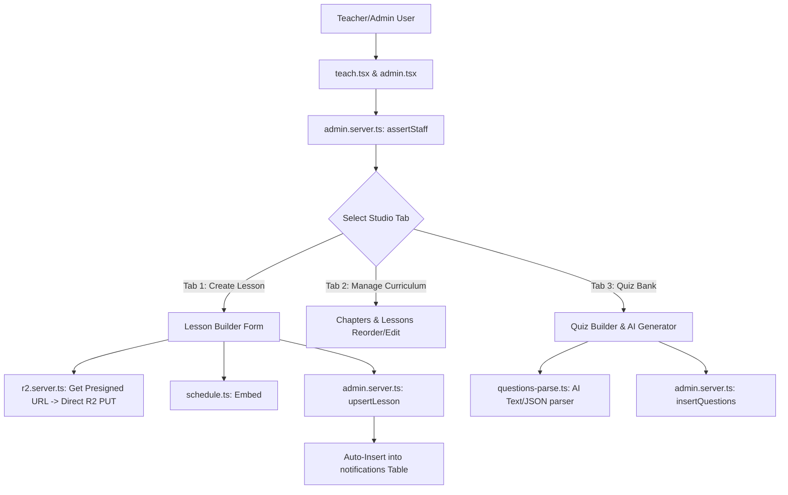
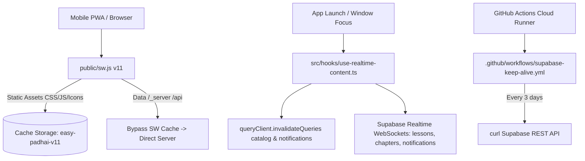

# Easy Padhai — Complete Architecture Flow & Branching Map

> **Document Status**: Living Architecture Map & Direct-Strike Guide  
> **Purpose**: Eliminates search latency and guesswork. Maps every user action directly from UI Component ➔ Client Hook ➔ Server Function ➔ Database Table.  
> **Rule for Engineers/AIs**: When tasked with any change, identify the matching Subsystem and Module below, navigate directly to the specified files, and make localized modifications without touching unrelated modules.

---

## High-Level System Architecture (The 5 Core Chunks)



---

## Chunk 1: Audio & Podcast Immersion Engine

This module is responsible for continuous lecture audio playback, mobile lock-screen controls, chapter transitions, voice announcements, and offline audio streaming.

### 1.1 Flow & Branching Pattern


### 1.2 Direct-Strike Traceability Matrix (Chunk 1)

| User Action / Problem Area | UI File to Touch | Logic / State Hook | Backend Server Function | DB Tables Touched | External Service |
| :--- | :--- | :--- | :--- | :--- | :--- |
| **Audio Play / Pause / Seek** | `src/components/media-player.tsx` | Local playback state (`isPlaying`, `currentTime`) | None (Client stream) | None | Cloudflare R2 (`pub-5b335...r2.dev`) |
| **Lock Screen Controls (Missing / Vanishing)** | `src/components/media-player.tsx` | `navigator.mediaSession` handlers (`play`, `pause`, `nexttrack`, `previoustrack`) | None | None | Mobile OS Media Notification |
| **Podcast Mode Transition Audio** | `src/components/media-player.tsx` | `src/lib/sound-effects.ts` (`playChapterTransitionSound`, `speakText`) | None | None | Web Audio API / SpeechSynthesis |
| **Podcast Mode Settings Modal** | `src/components/podcast-mode-dialog.tsx` | `src/lib/podcast.ts` | None | `localStorage` | Client Storage |
| **Speed & Pitch Control** | `src/components/media-player.tsx` | `playbackRate` controller | None | None | HTMLAudioElement |
| **Study Time Heartbeat** | `src/components/media-player.tsx` | `src/hooks/use-study-heartbeat.ts` | `src/lib/learn.server.ts` | `study_time`, `streaks` | Supabase DB |

---

## Chunk 2: Curriculum & Learning Journey

Handles class selection (Classes 9, 10, 11, 12), hierarchical navigation (Subject ➔ Chapter ➔ Lesson), PDF notes, and lesson progress tracking.

### 2.1 Flow & Branching Pattern


### 2.2 Direct-Strike Traceability Matrix (Chunk 2)

| User Action / Problem Area | UI File to Touch | Logic / State Hook | Backend Server Function | DB Tables Touched | External Service |
| :--- | :--- | :--- | :--- | :--- | :--- |
| **Change Class (9, 10, 11, 12)** | `src/components/class-switcher.tsx` | `src/hooks/use-active-class.ts` | None | `localStorage` (`ep_active_class`) | Client Storage |
| **Curriculum Home Catalog** | `src/routes/learn.index.tsx` | `useSuspenseQuery(catalogQuery)` | `src/lib/content.server.ts` (`fetchCatalog`) | `subjects`, `chapters`, `lessons`, `tests` | Supabase DB |
| **Chapter Detail & Playlist** | `src/routes/learn.$slug.tsx` | `useSuspenseQuery(chapterQuery)` | `src/lib/content.server.ts` (`fetchChapter`) | `chapters`, `lessons`, `tests` | Supabase DB |
| **PDF Notes & Document Viewer** | `src/routes/learn.$slug.tsx` | Embedded iframe / PDF viewer | None | Cloudflare R2 (`pdf_url`) | Cloudflare R2 |
| **Markdown Summary Notes** | `src/components/markdown-renderer.tsx` | `marked` + `dompurify` | None | `lessons.summary` | Client rendering |
| **Lesson Bookmarks** | `src/routes/learn.$slug.tsx` | Bookmark toggle | `src/lib/learn.server.ts` | `lesson_bookmarks` | Supabase DB |

---

## Chunk 3: Quiz & Assessment Engine

Handles test launches, interactive question timers, multiple-choice option validation, score calculations, streaks, and victory celebrations.

### 3.1 Flow & Branching Pattern


### 3.2 Direct-Strike Traceability Matrix (Chunk 3)

| User Action / Problem Area | UI File to Touch | Logic / State Hook | Backend Server Function | DB Tables Touched | External Service |
| :--- | :--- | :--- | :--- | :--- | :--- |
| **Launch Quiz / Test** | `src/routes/learn.$slug.tsx` | Navigation to `/test/:testId` | `src/lib/tests.server.ts` (`fetchTestDetails`) | `tests`, `questions` | Supabase DB |
| **Quiz Runner Screen** | `src/routes/test.$testId.tsx` | Local quiz state (`selectedAnswers`, `timer`) | `src/lib/tests.server.ts` | None | Client State |
| **Question Count Calculation** | `src/lib/admin.server.ts` (Admin) / `src/lib/content.server.ts` (User) | Nested relation `tests.select("*, questions(id)")` | `fetchAdminCatalog` / `fetchCatalog` | `tests`, `questions` | ⚠️ **Never flat select questions table!** |
| **Score Submission & Streaks** | `src/routes/test.$testId.tsx` | Submission handler | `src/lib/tests.server.ts` (`recordAttempt`) | `test_attempts`, `streaks`, `profiles` | Supabase DB |
| **Victory & Confetti Modal** | `src/components/victory-modal.tsx` | `canvas-confetti` | None | None | Client Animation |
| **Daily Challenge / Quick Quiz** | `src/routes/c.$code.tsx` | Challenge runner | `src/lib/challenges.server.ts` | `tests`, `questions`, `streaks` | Supabase DB |

---

## Chunk 4: Teacher & Creator Studio (`/teach` & `/admin`)

Handles curriculum authoring, lesson publishing, scheduled releases (drip content), audio compressor, direct Cloudflare R2 uploads, and bulk quiz generation.

### 4.1 Flow & Branching Pattern


### 4.2 Direct-Strike Traceability Matrix (Chunk 4)

| User Action / Problem Area | UI File to Touch | Logic / State Hook | Backend Server Function | DB Tables Touched | External Service |
| :--- | :--- | :--- | :--- | :--- | :--- |
| **Teacher Role Gate** | `src/routes/teach.tsx` | `isStaff` check | `src/lib/admin.server.ts` (`assertStaff`) | `user_roles` | Supabase DB |
| **Create / Edit Lesson Form** | `src/routes/teach.tsx` (Lines ~980–1100, ~1900–1950) | Form State | `src/lib/admin.server.ts` (`upsertLesson`) | `lessons`, `notifications` | Supabase DB |
| **Audio File Upload & Compress** | `src/components/media-input.tsx` | `src/lib/audio-compressor.ts` | `src/lib/r2.server.ts` (`getPresignedUploadUrl`) | None | Cloudflare R2 Direct PUT |
| **Scheduled / Drip Release** | `src/routes/teach.tsx` | `src/lib/schedule.ts` (`injectLessonSchedule`, `localDateTimeToIso`) | `src/lib/admin.server.ts` (`upsertLesson`) | `lessons.summary` (`<!--SCHEDULED:ISO-->`) | Asia/Kolkata (+05:30) |
| **AI Quiz Generator / Bulk Parser** | `src/routes/teach.tsx` (Tab 3) | `src/lib/questions-parse.ts` | `src/lib/admin.server.ts` (`insertQuestions`, `upsertTest`) | `tests`, `questions` | Google Gemini API |
| **Admin Owner Controls** | `src/routes/admin.tsx` | Admin Dashboard | `src/lib/owner.server.ts`, `src/lib/admin.server.ts` | `user_roles`, `profiles`, `credit_events` | Supabase DB |

---

## Chunk 5: Offline, Realtime & Sync Engine

Handles Service Worker PWA lifecycle, cache invalidation, push alerts, scheduled drip notification delivery, and database keep-alive pings.

### 5.1 Flow & Branching Pattern


### 5.2 Direct-Strike Traceability Matrix (Chunk 5)

| User Action / Problem Area | UI File to Touch | Logic / State Hook | Backend Server Function | DB Tables Touched | External Service |
| :--- | :--- | :--- | :--- | :--- | :--- |
| **PWA Stale Content Bug** | None | `public/sw.js` (Must be `v11+`, exclude `/_server`, `/api`) | None | None | Service Worker Cache |
| **Tab / Screen Unlock Freshness** | None | `src/hooks/use-realtime-content.ts` | Invalidate `["catalog"]`, `["my-notifications"]` | None | TanStack Query Cache |
| **Realtime Toast on Upload** | None | `src/hooks/use-realtime-content.ts` | Supabase Postgres Changes Channel | `lessons`, `notifications` | Supabase Realtime |
| **Notification Bell Dropdown** | `src/components/notification-bell.tsx` | `useQuery(["my-notifications"])` | `src/lib/notifications.server.ts` (`getNotificationsForUser`) | `notifications` | Supabase DB |
| **Supabase Auto-Pause Protection** | None | `.github/workflows/supabase-keep-alive.yml` | `scripts/keep_alive.mjs` | `subjects` | GitHub Actions Runner |
| **PWA Install Banner** | `src/components/install-pwa-button.tsx` | `beforeinstallprompt` event | None | None | Browser PWA Prompt |

---

## Quick-Lookup "Direct Strike Index" (Common Requests ➔ Exact Files)

When an issue or feature request is raised, jump directly to the target file:

```
"Quiz question count is wrong / 0"            ➔ src/lib/admin.server.ts (fetchAdminCatalog)
"Audio stops on lock screen / next lecture"   ➔ src/components/media-player.tsx (setupMediaSession)
"New lecture uploaded but users can't see it" ➔ public/sw.js (CACHE_NAME version & exclude list)
"Notification not ringing for new lectures"    ➔ src/lib/admin.server.ts (upsertLesson shouldNotify)
"Add/Modify field in lesson upload form"      ➔ src/routes/teach.tsx (Lines ~980–1080)
"Change class level / add new class"          ➔ src/lib/classes.ts & src/hooks/use-active-class.ts
"Timezone shifted by 5.5 hours in schedule"   ➔ src/lib/schedule.ts (localDateTimeToIso)
"Database connection error / MCP check"       ➔ PROJECT_CONNECTIONS.md (DO NOT USE MCP)
"Upload PDF or Audio fails"                   ➔ src/lib/r2.server.ts (Cloudflare S3 Presigner)
```
